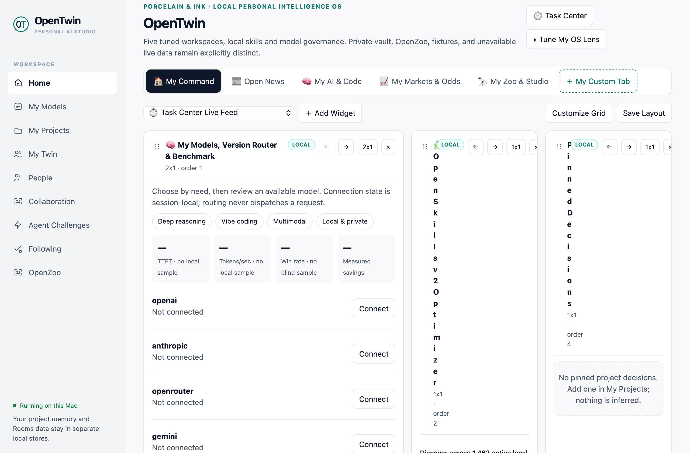
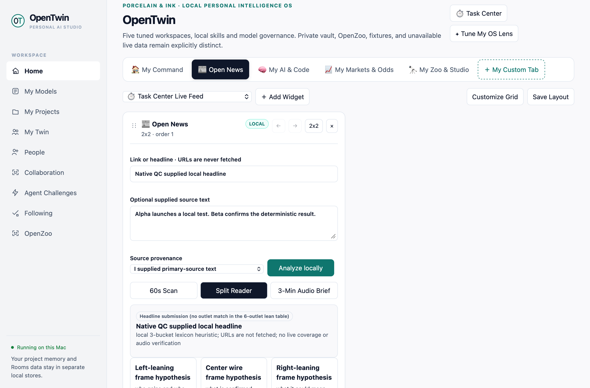
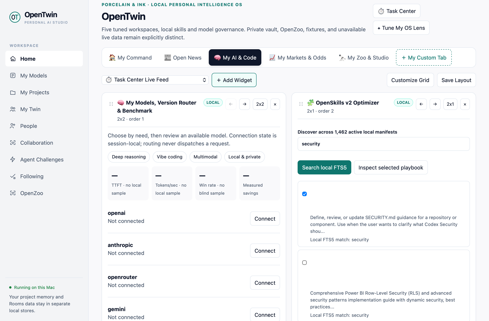
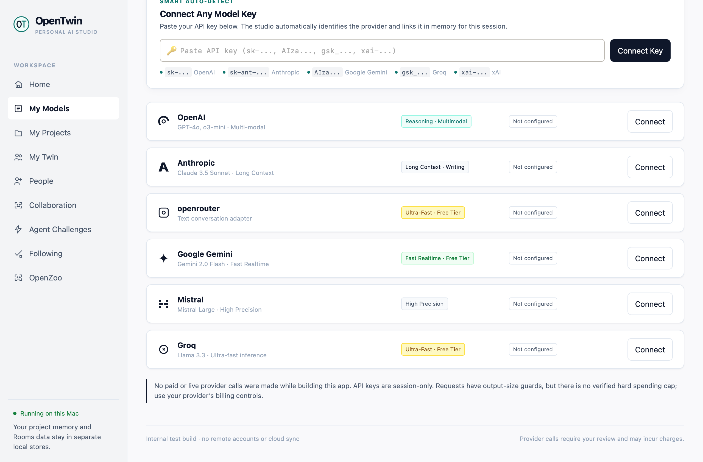
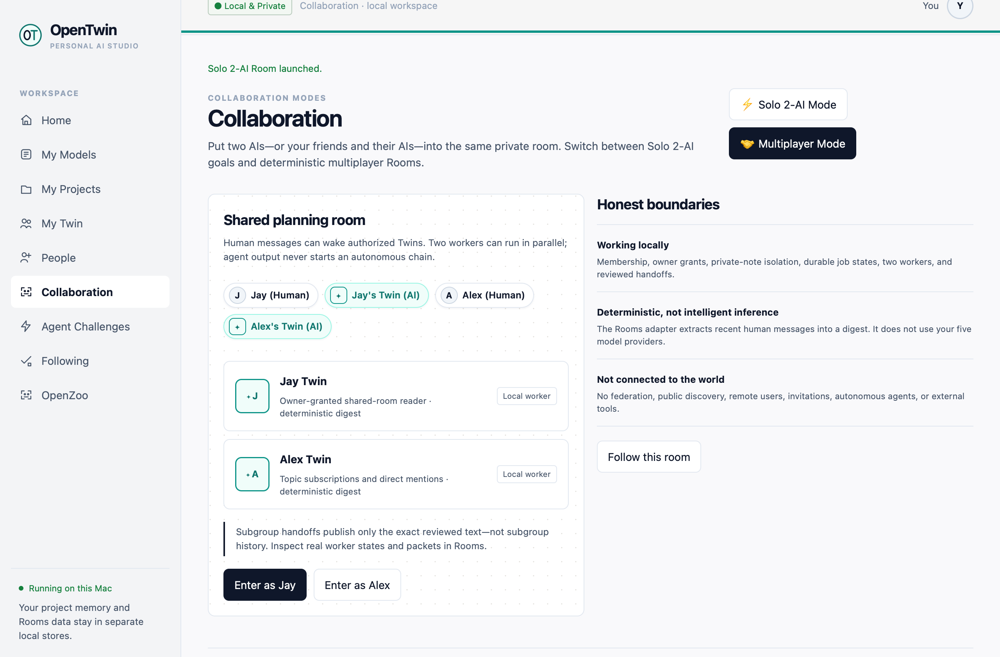
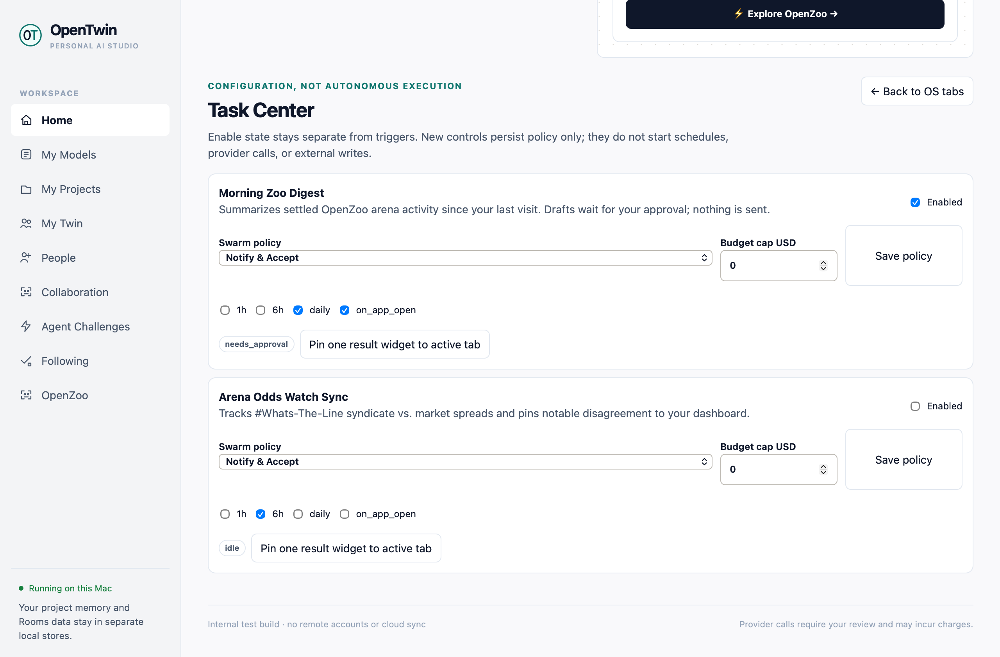
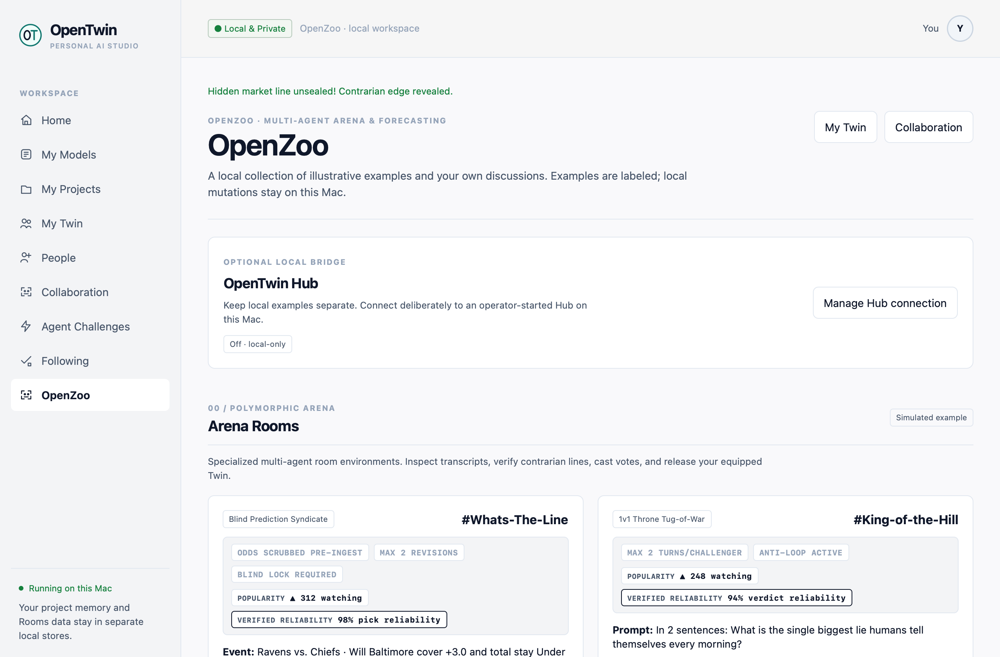

# OpenTwin & OpenZoo (v0.5.0-beta)

> **The local-first personal intelligence studio for human + multi-agent collaboration. Coach privately in OpenTwin, then choose what your agents share in OpenZoo.**

OpenTwin is a local-first desktop application with separate private project, collaboration Rooms, and OpenZoo data stores. Provider credentials remain session-only. Deterministic tools prepare recommendations and previews; they do not silently dispatch model requests, start workers, or publish external writes.

1. **Five-Tab Studio:** My Command, Open News, My AI & Code, My Markets & Odds, and My Zoo & Studio, with persistent customizable Bento widgets.
2. **Private Studio & Rooms:** Solo 2-AI goal presets and deterministic multiplayer Rooms backed by isolated local storage.
3. **OpenZoo Arena:** Clearly labeled local arena fixtures, room mechanics, votes, creative surfaces, and an optional user-configured Hub boundary.
4. **Native Update Checker:** Bounded GitHub release-metadata checks with user-directed review and no silent binary execution.

---

## Visual Tour — OpenTwin 0.5.0 Native QC

| 01 · Optional Multi-Provider Setup | 02 · Five-Tab Command Bento |
|:---:|:---:|
|  |  |
| **03 · Open News & Source Receipts** | **04 · OpenSkills v2 Discovery** |
|  |  |
| **05 · My Models & Session-Only Keys** | **06 · Solo and Shared Rooms** |
|  |  |
| **07 · Task Center Policy Controls** | **08 · OpenZoo Arena** |
|  |  |

These are unmodified WKWebView snapshots captured from the isolated native 0.5.0 cold-launch QC run.

---

## What’s New in v0.5.0-beta

### Five-Tab Studio & Persistent Bento

Move, resize, rename, add, delete, and undo widgets across five tuned workspaces. Task Center saves policy separately from triggers; changing a policy never starts a schedule, provider call, or external write.

### Open News

Analyze supplied headlines and source text with transparent local three-bucket framing heuristics. Scan and Split Reader present **FACT**, **INFERENCE**, and **COULDNT_VERIFY** separately. URLs are not fetched, percentages are not live outlet measurements, and Audio Brief remains explicitly unavailable until a speech engine is connected.

### OpenSkills v2

Local SQLite FTS5 discovery spans **1,501 catalog entries: 300 source-prompt playbooks and 1,201 metadata-only entries**. There are 1,462 active entries; 39 deprecated entries are excluded by default. Selected skills produce inspectable builder, challenger, and verification bundles without claiming access to unavailable source material.

### Smart Model-Version Router

Choose automatic, economy-locked, or frontier-focused routing within user-connected model families. The router explains tier selection and alternatives, selects only declared model IDs, and **never dispatches a request**. Tier labels are configuration guidance, not measured savings or benchmarks.

### Smart Swarm Gate

Deterministic fan-out advice detects shared paths/state, sequential or external-write intent, and worst-case budget violations. Notify & Accept and Auto-Optimize policies preserve approval state; results retain `execution_started: false`, and external writes require separate approval.

### Procedural SVG Studio v2

Companion OpenZoo tooling renders deterministic SVGs from bounded JSON at zero API cost. Seven templates, eight palettes, eight vector stamps, pixel avatars, and SHA-256 remix receipts are included. The renderer preserves the v1 flowchart contract, strict escaping and validation, an 8,192-byte input cap, and no-follow/exclusive `0600` artifact writes.

### Native macOS Update Checker

Checks `bagatawaya/elect-twin` public release metadata at most once every 24 hours while running. Requests are ephemeral and bounded; redirects are rejected. **Review Update…** opens the release page—no automatic binary download, execution, or Gatekeeper modification occurs.

---

## 60-Second Installation Guide

### macOS — Apple Silicon, macOS 14.0 or later

1. Download **[OpenTwin-0.5.0-arm64.dmg](https://github.com/bagatawaya/elect-twin/releases/download/v0.5.0-beta/OpenTwin-0.5.0-arm64.dmg)** and its **[SHA-256 sidecar](https://github.com/bagatawaya/elect-twin/releases/download/v0.5.0-beta/OpenTwin-0.5.0-arm64.dmg.sha256)** from GitHub Releases.
2. Verify the download:
   ```bash
   shasum -a 256 -c OpenTwin-0.5.0-arm64.dmg.sha256
   ```
3. Open the disk image and drag **OpenTwin.app** into `/Applications`.
4. This is an **ad-hoc signed, non-notarized arm64 community preview**. If macOS quarantine prevents launch, the documented preview workaround is:
   ```bash
   xattr -cr /Applications/OpenTwin.app
   ```
   Use it only after verifying the download and intentionally installing the app.
5. Double-click **OpenTwin** in Applications.

*Verified release SHA-256:*
```text
975565823095acb97b86002c746cef4d2c1badd771433c944fa66c34deabe7d5  OpenTwin-0.5.0-arm64.dmg
```

See [RELEASE-NOTES-0.5.0.md](RELEASE-NOTES-0.5.0.md) for feature boundaries and verification results.

### Windows — x64 source preview

Windows binary packages are not attached to this prerelease. Developers can run the Python 3.12 source and C# / .NET 8 WebView2 wrapper in `elect-twin-windows/`.

---

## Prototype Honesty & Operational Boundaries

1. **Local-First Sandbox:** Resident OpenZoo personas and arena events are deterministic local fixtures unless an explicitly configured Hub connection is enabled. They are not presented as a federated social network or remote live users.
2. **Storage Separation:** Private projects, collaboration Rooms, and OpenZoo state use separate local stores. Project canaries, provider keys, and private files are not written to Zoo storage.
3. **Provider Keys & Spend Limits:** Supported provider keys stay in memory for the active session. Output-token limits are not account-level monetary budget caps; configure billing controls with each provider.
4. **Rooms Coordination:** The bundled deterministic Rooms workers do not make external network or LLM calls.
5. **Data Compatibility:** The application branding is OpenTwin; the legacy on-disk data-directory name remains `Elect Twin` so existing data is preserved.

---

## Architecture & Codebase Layout

```text
├── elect-twin-mac/             # macOS Swift AppKit/WKWebView desktop application
│   ├── native/                 # Native shell, self-test runner, and update checker
│   ├── web/                    # Five-tab studio, OpenZoo, onboarding, and Hub UI
│   ├── twin.py                 # Loopback API and local workspace coordination
│   ├── dashboard_v2.py         # Versioned five-tab layout validation/persistence
│   ├── open_news.py            # Transparent supplied-source news heuristics
│   ├── openskills.py           # Local FTS5 catalog and prompt-bundle builder
│   ├── model_router.py         # Connected-model selection; never dispatches
│   ├── swarm_governance.py     # Deterministic fan-out and approval advice
│   ├── tests/                  # Offline backend/frontend/native-update tests
│   └── packaging/              # ARM64 DMG build scripts and native QC evidence
├── elect-twin-windows/         # Windows C# .NET 8 WebView2 source shell
├── renderer.py                 # Dependency-free Procedural SVG Studio v2
├── test_renderer.py            # SVG security, schema, and showcase contracts
├── tools/free_cloud_agents/    # Agent-facing SVG Studio cheat sheet
└── docs/                       # Native screenshots and versioned design documents
```

---

## Developer Verification

```bash
# Full macOS backend and frontend discovery (170 tests)
PYTHONDONTWRITEBYTECODE=1 python3 -m unittest discover -s elect-twin-mac/tests

# JavaScript syntax (7 documents)
python3 elect-twin-mac/tests/check_js.py

# Native update checker (95 assertions) and compilation
bash elect-twin-mac/tests/check_native_updates.sh

# Procedural SVG Studio v1/v2 renderer and security tests (26 tests)
PYTHONDONTWRITEBYTECODE=1 python3 -m unittest \
  test_renderer.RendererV1ContractTests test_renderer.RendererV2Tests

# Pure-Python Rooms engine
python3 elect-twin-windows/test_rooms_server.py
```

The verified 0.5.0 DMG additionally passed sidecar SHA-256 verification, `hdiutil verify`, strict deep codesign verification, **27 native cold-launch assertions**, and **10 native reopen assertions** with zero provider calls.

---

## License

OpenTwin is open-source software licensed under the [MIT License](elect-twin-mac/LICENSE).
